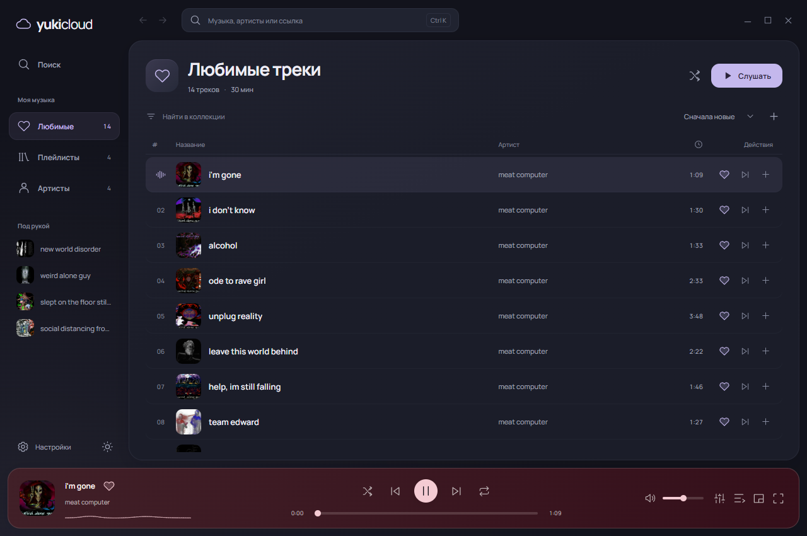
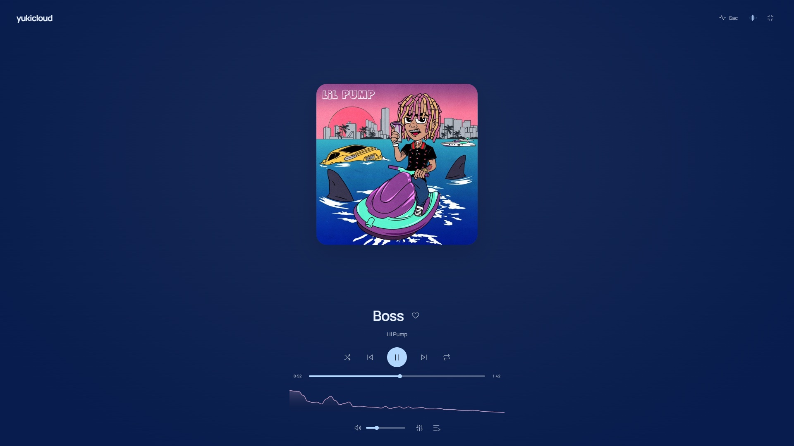
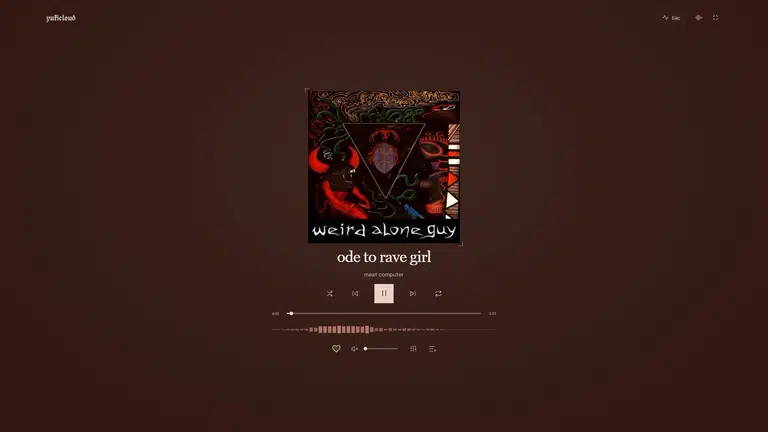
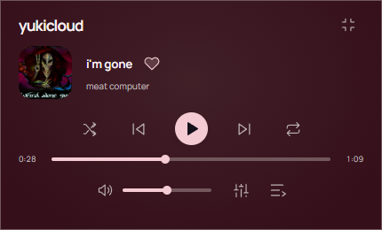
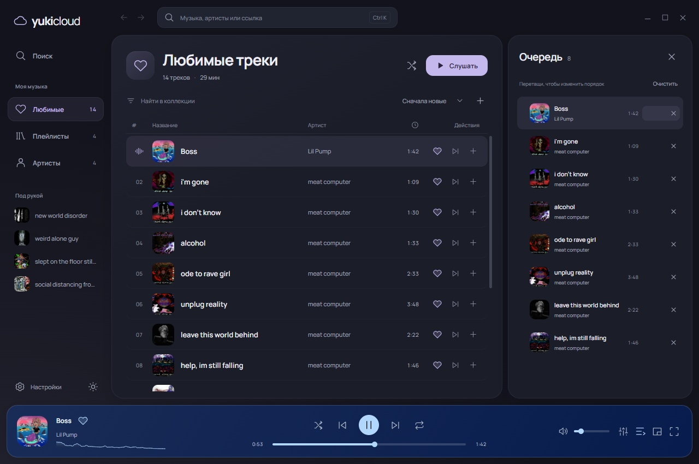
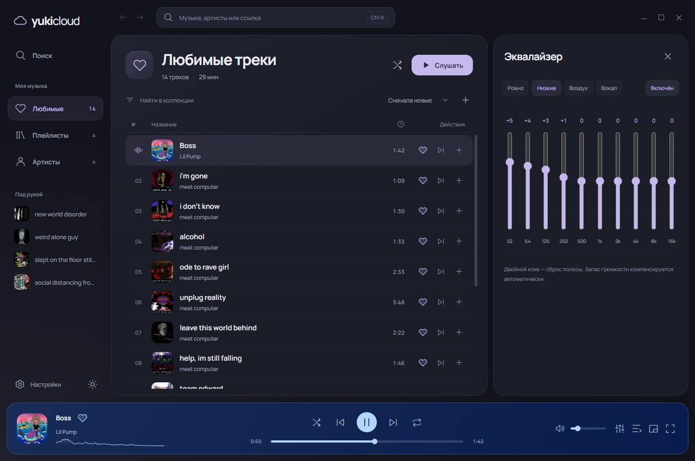

# yukicloud

SoundCloud для Windows. Спокойное пространство для музыки: отдельные разделы, мягкая геометрия и плеер, который всегда под рукой.

**Windows 10 / 11 · x64**

Версия **0.2**: новый интерфейс, две темы, отдельные разделы и переработанный спектр звука.

[Скачать установщик](https://github.com/MaimeD666/yukimusic/releases/download/v0.2/yukicloud_0.2.0_x64-setup.exe) · [Portable](https://github.com/MaimeD666/yukimusic/releases/download/v0.2/yukicloud_0.2.0_x64-portable.zip) · [Все файлы релиза](https://github.com/MaimeD666/yukimusic/releases/tag/v0.2)



[Светлая тема](docs/screenshots/redesign-light.png). Превью нового интерфейса сняты в браузере с тестовым мостом к нативным командам и сохранёнными обложками.

## Музыка в своём пространстве

«Любимые», «Плейлисты» и «Артисты» — самостоятельные разделы. Поиск открывается отдельно, результаты переключаются между треками, артистами и плейлистами. У артиста и плейлиста свой экран; кнопки назад и вперёд возвращают фильтр, сортировку и место в списке. Следующие результаты подгружаются сами, длинные списки виртуализированы.

- Две темы: тёмная «Лунная» по умолчанию и светлая «Облачная». Выбор сохраняется.
- Фильтр коллекции, сортировка треков и воспроизведение всего списка обычным порядком или вперемешку.
- Постоянный нижний плеер, быстрые ссылки на плейлисты и действия рядом с каждым треком.
- «Слушать» на карточке запускает музыку без перехода. Удаление артиста или плейлиста — через ПКМ с подтверждением; наведение не двигает элементы.
- Очередь и эквалайзер открываются сбоку, сохраняя доступ к рабочему списку. В маленьком окне навигация сжимается до иконок.
- Полный экран, мини-плеер, контекстное меню и настройка звука сохраняют прежние возможности.

Скриншоты ниже относятся к опубликованной версии 0.1.

- Локальная коллекция любимых треков, артистов и плейлистов.
- Полные треки плейлистов и постраничная загрузка каталога артиста, включая неполные ответы API.
- Очередь с перетаскиванием, «следующим», «в конец», shuffle и тремя режимами повтора. Два одинаковых трека — два отдельных места в очереди.
- Недоступные записи пропускаются. Буферизация и временные ошибки сети сохраняют трек в очереди.
- Собственная громкость, десятиполосный эквалайзер ±12 dB и пресеты.
- Свой ПКМ: трек, артист, плейлист и очередь получают подходящие действия.
- Медиа-клавиши Windows и кнопки предыдущего трека, паузы и следующего под превью в панели задач.
- Автоматический переход на новое устройство вывода Windows с сохранением позиции, громкости и EQ.

## Полный экран и бас-режим

Палитра извлекается из обложки в OKLab: меняется весь плеер, включая фон и текст. Контраст проверяется отдельно. Спектр строится по реальному аудио.



Кнопка **«Бас»** или **B** включает отклик низких частот: удар обложки и цветного света. Кнопки остаются на месте, чтобы дроп не пришлось ловить мышкой. Режим визуальный; настройку звука оставили эквалайзеру.



На паузе эффект затихает, в фоне останавливается. При системном ограничении анимаций пульсация отключена. Скриншоты и анимация здесь сняты с работающего приложения.

## Маленький, но с характером

Мини-плеер закрепляется поверх окон. Разворачивается обратно одной кнопкой. Работу делать всё ещё придётся, зато саундтрек уже есть.



<details>
<summary>Очередь и эквалайзер</summary>




</details>

## Сколько ест

| Режим | Working set всей группы | Private commit | CPU |
| --- | ---: | ---: | ---: |
| Открытое окно, музыка и спектр | 464.1 MiB | 277.5 MiB | 1.306% |
| Полный экран и бас-режим | 466.6 MiB | 300.4 MiB | 1.066% |
| В трее, музыка играет | 70.0 MiB | 45.2 MiB | 0.033% |
| В трее, пауза | 70.1 MiB | 45.2 MiB | 0.011% |

Замер всей группы процессов: приложение, WebView2 и FFmpeg. Windows 10, i7-14700K, 32 ГБ RAM, монитор 165 Гц; интервалы по 10 секунд. CPU указан как доля общей мощности всех 28 логических процессоров. Working set суммируется, поэтому общие страницы могут учитываться несколько раз. Это ориентир для этого ПК, а не обещание одинаковых цифр на любом железе. [Исходные замеры](docs/measurements.json).

После скрытия в трей WebView выгружается через 30 секунд. Звук, очередь и системные медиа-кнопки продолжают работать в Rust. При открытии интерфейс создаётся заново. В памяти держится до 16 MiB сжатого аудио; заранее подготавливается следующий трек. Вся очередь целиком не скачивается.

В проверке релиза: старт без прогретого кэша — около **858 мс**, перемотка по загруженным данным — **34–49 мс**, подготовленный следующий трек — около **206 мс**. Измерялось появление PCM/состояния воспроизведения, без задержки физического аудиоустройства; сеть и доступность CDN влияют на результат.

## Из чего собрано

| Часть | Что внутри |
| --- | --- |
| Окно и интеграция Windows | Tauri 2, Rust, WebView2, Win32 |
| Интерфейс | Svelte 5, TypeScript, CSS, Canvas |
| Звук | Rust, rodio / WASAPI, отдельный FFmpeg 8.0.1 |
| Эквалайзер | Каскад biquad-фильтров с запасом громкости при усилении |
| Спектр и бас | FFT реального PCM, перекрывающиеся окна, отрисовка по частоте экрана |
| Обложки | OKLab, проверка контраста, локальный кэш |
| API | Публичный SoundCloud API v2; получение client_id из публичных JS-файлов сервиса |

FFmpeg собран специально для декодирования аудио: примерно **2,1 MiB**, без видеокодеков и внешних мультимедийных библиотек. Установщик приложения — примерно **5,1 MiB**. WebView2 использует установленный системный Runtime; при его отсутствии установщик предложит загрузку.

## Управление

| Клавиши | Действие |
| --- | --- |
| Ctrl K | Поиск |
| Alt ← / → | Назад / вперёд по экранам |
| Пробел | Воспроизведение / пауза |
| F | Полноэкранный плеер |
| B | Бас-режим в полноэкранном плеере |
| M | Мини-плеер |
| Q | Очередь |
| ← / → | Перемотка на 5 секунд |
| Shift ← / → | Предыдущий / следующий трек |
| Escape | Закрыть панель или вернуться из плеера |

Крестик убирает приложение в трей. **Полный выход — через меню трея.** Коллекция и настройки лежат в `%APPDATA%/dev.maimed.yukicloud`; для резервной копии достаточно сохранить эту папку после выхода.

## Собрать самому

Нужны Windows x64, Node 22+, Rust stable с MSVC, Visual Studio Build Tools с C++ и Windows SDK, Python 3.11+.

```powershell
npm ci
python scripts/prepare-ffmpeg.py
powershell -NoProfile -ExecutionPolicy Bypass -File scripts/dev.ps1
```

Скрипт FFmpeg скачивает закреплённые версии исходников и переносимых инструментов, проверяет SHA256 и собирает декодер в `.tools`. Системные компиляторы и настройки не заменяет.

```powershell
powershell -NoProfile -ExecutionPolicy Bypass -File scripts/test.ps1
powershell -NoProfile -ExecutionPolicy Bypass -File scripts/build.ps1
powershell -NoProfile -ExecutionPolicy Bypass -File scripts/package.ps1
```

Готовые файлы появятся в `release/`. `npm run dev` открывает браузерный предпросмотр; поиск и звук работают в настольной сборке. GitHub Actions повторяет сборку Windows и публикует релиз `v0.2` после успешных проверок. Если релиз уже существует, новая сборка остаётся артефактом запуска и не заменяет опубликованные файлы.

Автотесты проверяют очередь, DSP, буферизацию, палитру и бас. Отдельные нативные проверки покрывают реальный SoundCloud, точность MP3/HLS-перемотки, подгрузку списков и 49 сценариев геометрии окна. [Подробнее о проверках](docs/testing.md).

## Маленький шрифт, обычным размером

Это неофициальный клиент SoundCloud и ранняя версия **0.1**. API v2 внутренний: изменения сервиса могут потребовать обновления клиента. Региональные ограничения и доступность записей определяет SoundCloud.

Коллекция **локальная**: входа в аккаунт и синхронизации лайков пока нет. Также нет офлайн-загрузки, gapless и crossfade. «Минимализм» здесь иногда честно означает «ещё не написали».

FFmpeg распространяется отдельным заменяемым исполняемым файлом под LGPL 2.1+. Его точный исходный архив приложен к релизу; конфигурация сборки — в `scripts/ffmpeg-configure.sh`. Лицензии компонентов и шрифтов: [THIRD-PARTY](src-tauri/resources/THIRD-PARTY.txt), [шрифты](public/fonts).
